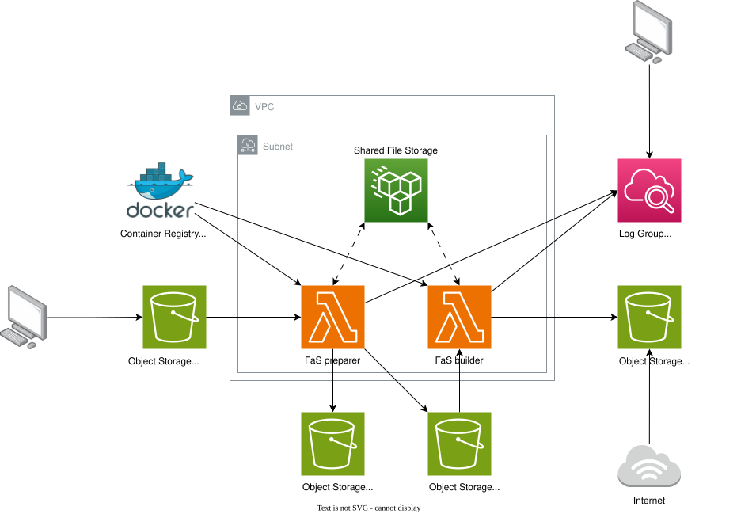

# Digital monography

Platform for scholars of digital humanities to publish their digital work

## Architecture design

### Simplified diagram



### Infrastructure visualization


## Updating code

Images are hosted in the Docker Hub registry. When applying changes in the terraform configuration, AWS will pull images from Docker Hub, build and deploy them using the tags specified in the `.versions.json` file. Note that only the stable tags will be used.

In order to push images to the Docker Hub, you first have to login to the registry. Note that the `Makefile` exposes common commands for building, tagging and pushing important docker images. We strongly advise using the `Makefile` commands. For example when you made some stable changes to the Preparer Lambda code, you can push your changes using the following commands.

```sh
# Update the stable version of the preparer image
vim .versions.json
# Login to Docker Hub
make login
# Build the preparer image
make preparer/build
# Tag the preparer image with the tag specified as stable in the .versions.json file
make preparer/tag
# Push docker image to the docker registry
make preparer/push
```

Note that pushing the image to the docker registry itself will not update the code deployed to the AWS infrastructure. For that you need to trigger the CI/CD pipeline, for example by pushing `.versions.json` code to the main or the develop branch.

See `Makefile` and `.gitlab-ci.yml` for details.

## Updating infrastructure configuration

Changes to the Terraform Infrastructure as Code will be updated automatically after push to `main` and `develop` branches.

See `.gitlab-ci.yml` for details.

## Encrypting secret files

To encrypt a file, use the sops tool.

```sh
sops -e secrets/dev.tfvars.json > secrets/dev.tfvars.enc.json
```

To set up sops, you can follow the [official instructions](https://github.com/getsops/sops) or [unofficials guides](https://dev.to/stack-labs/manage-your-secrets-in-git-with-sops-g0a).

## AWS setup for development

Steps to configure the platform __for development__ on your own AWS account.
Note that this setup is different than the configuration for "test" and "live" environments on the AWS account of De Gruyter.

### Configure an Identity Provider in AWS IAM

Configure GitLab as an identity provider for IAM. This will allow IAM to recognize GitLab as a trusted entity that we can assign permissions via an IAM Role.
Navigate to IAM in the AWS Management Console, and then click on "Identity Providers" on the sidebar under "Access Management". After that, click on the button saying "Add provider" on the top right-hand side.

Make sure that the option for OpenID Connect is selected on the top, this is because OpenID Connect allows you to configure trust relationships with third party accounts including but not limited to GitLab. Also ensure that the provider URL is GitLab's root URL, https://gitlab.com as well as the Audience. The provider URL is the URL from which the OpenID configuration is obtained. See [this walkthrough](https://community.aws/content/2dquEzIKfm2wVH77AYmApToZdWj/gitlab-with-terraform) for details.

### Create an IAM Role for GitLab CI

Click on "Roles" under "Access Management" in the IAM page and then click on the "Create role" button on the top right of the page to create IAM Role that the CI/CD pipeline can assume to make deployments.

See the `secrets/` dir to find IAM Policy to attach to that IAM Role.

Once the role is created, navigate to it in the console under "Roles" by searching for the role name before clicking on the role itself. Once you are on the role's page, select the "Trust relationships" tab and click on "Edit trust policy" on the right side of the page. Edit the condition in the trust policy to something like this:

```json
{
    "Version": "2012-10-17",
    "Statement": [
        {
            "Effect": "Allow",
            "Principal": {
                "Federated": "arn:aws:iam::<AWS_ACCOUNT_ID>:oidc-provider/gitlab.com"
            },
            "Action": "sts:AssumeRoleWithWebIdentity",
            "Condition": {
                "StringLike": {
                    "gitlab.com:sub": [
                        "project_path:C2DH/digital-monography:ref_type:branch:ref:main",
                        "project_path:C2DH/digital-monography:ref_type:branch:ref:develop"
                    ]
                }
            }
        }
    ]
}
```

### Create terraform state backend

Head over to the S3 page in the AWS Console and click "Create bucket" on the right side. Give the bucket a globally unique name.

Update the "bucket" field file "terraform.backend" in the `main.tf` file with the name of the new bucket.

### Create state lock table

Create a DynamoDB Table, we can visit the DynamoDB page on the AWS Console, and click on "Create table" on the right side of the page. Make sure it is done in the same region as the S3 bucket. Call the Partition Key "LockID" and set it to be a string. I recommend choosing the On-demand plan and add appropriate tags. We can leave the rest as the default settings and click on "Create table".

Update the "dynamodb_table" field file "terraform.backend" in the `main.tf` file with the name of the new table.

The `main.tf` can look something like:

```
terraform {
  backend "s3" {
    bucket         = "[NAME_OF_STATE_BACKEND_BUCKET]"
    key            = "statefile.tfstate"
    dynamodb_table = "[NAME_OF_LOCL_DB_TABLE]"
    encrypt        = true
    profile        = "oidc"
  }
}

provider "aws" {
  profile = "oidc"
  region  = var.region
}
```

### Add variables to GitLab repository

Go to the home page of the GitLab repository, and click on "CI/CD" under the "Settings" dropdown menu on the very bottom of the sidebar. Then click "Expand" on the "Variables" section and click on "Add variable". Have the Key be "ROLE_ARN" and the value be the ARN of the Role created in the step above. Remember to select the option "Protect variable".

Also, add the "AWS_DEFAULT_REGION" variable with value equal to the AWS region selected for the above mentioned resources.

## Sundry

### Generating infrastrucutre visualisation

To generate a visualization of an infrastructure as defined by .tf IaC files follow these steps:

1. Copy current project directory so that you don't have to migrate state nor reconfigure. E.g. `cp digital-monography tfgraph`.
1. Initalize terraform locally with `terraform init`.
1. Run `terraform graph`.
1. Copy output from terraform graph command to [WebGraphViz](http://www.webgraphviz.com/?tab=map) and select on "Generate Graph".
1. Save the '<div id="graphviz_svg_div">' tag as "graphviz.html" in the root of the project.

