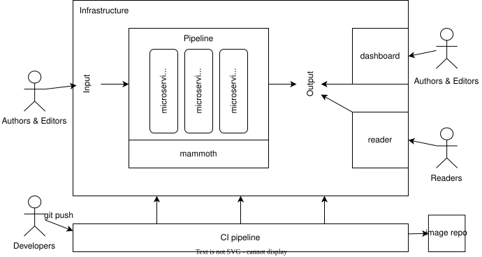
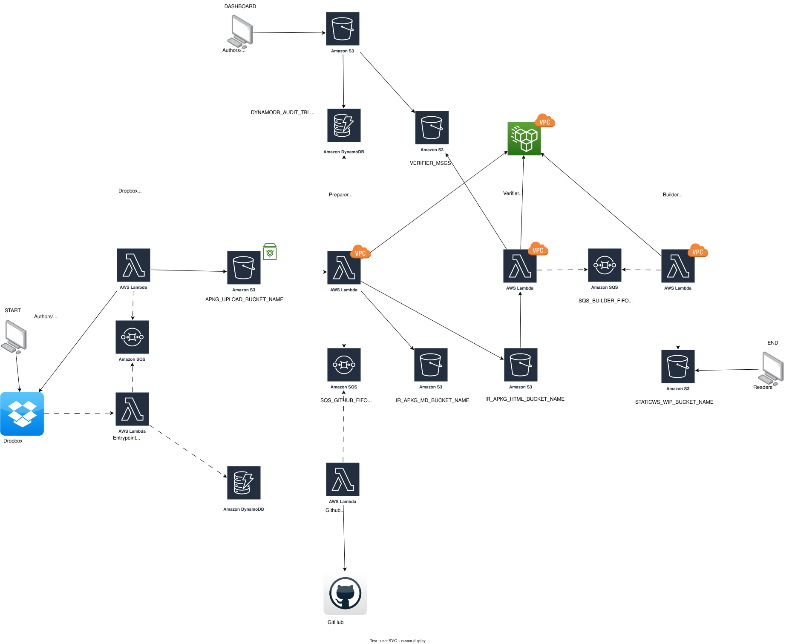

# Digital monography

Platform for scholars of digital humanities to publish their digital work.

## Documentation

[Notes and materials related with the project](https://uniluxembourg-my.sharepoint.com/:f:/r/personal/pawel_kaminski_uni_lu/Documents/Digital%20Monography%20Documents?csf=1&web=1&e=YYBKgk) can be found on the University's OneDrive shared directory. Access to the directory is given upon request. Some of other important project documents include:
* [Jira board](https://degruyter.atlassian.net/jira/software/projects/TNB/boards/59);
* [concept document](https://docs.google.com/document/d/1-iBdDUBQe8O8vU5hF83HuAKAacU7xEpgUfpdi975-CM/edit?exids=71471482,71471477&tab=t.0);
* [notes from meetings related to the project](https://uniluxembourg-my.sharepoint.com/:f:/r/personal/pawel_kaminski_uni_lu/Documents/Digital%20Monography%20Documents/Meeting%20Notes?csf=1&web=1&e=Mbc9E9);
* [notes from workshop of 7th December 2023](https://docs.google.com/document/d/1DniLbpg7pNBygPI1s-L6i6DjEW4tjvXVBhYtyFm1wyg/edit?tab=t.0);
* [author's guidelines for drafting manuscripts](https://cpy-dgtmon-dev-staticws-wip.s3.eu-west-1.amazonaws.com/read/guidelines-for-drafting-manuscripts/index.html).

The development cycle is based on release cycles 4 months each. The direction of development is coordinated with project's partners during monthly meetings.

## CI/CD pipeline status

| Branch  | Status |
| ------- | ------ |
|   main  | [](https://gitlab.com/uniluxembourg/c2dh/private/degruyter/digital-monography/-/commits/main) |
| develop | [](https://gitlab.com/uniluxembourg/c2dh/private/degruyter/digital-monography/-/commits/develop) |

## Design principles

* Sustainability is the highest priority of this project. Books should be hosted as static web pages without a need for dedicated servers. When possible, websites related to the project should, like the dashboard, should not require any application logic on the server-side after web pages are built.
* Rely on features of MS Word for `.docx` input, JupyterLab/Notebook for `.ipynb` input and on JupyterBook/Sphinx-doc for output as much as possible.
* Target MyST specification rather that bespoke solutions.

## Architecture design

### Architecture overview

The project consists of the following main software components.

| Name | Layer | Description |
| ---- | ----- | ----------- |
| pipeline | BL | Microservices that process input manuscript, verify it, and build output for other apps to use. The pipeline includes multiple micro services that are described below. |
| [mammoth](https://github.com/kaminski-pawel/python-mammoth) | BL | Python library for transforming `.docx` into markdown. |
| [CI pipeline](./.gitlab-ci.yml) | DevOps | Set of scripts for applying changes to the infrastructure. |
| [dashboard](staticws/dashboard/) | UI | Dashboard with tools for authors and editors to help their work on the manuscript. |
| [reader](staticws/reader/) | UI | Copy of degruyter.com website to show how the digital books can be integrated with de Gruyter's platform. |



### Details of pipeline architecture



For the full architecture see [the instructions on generating an infrastrucutre visualisation](#generating-infrastrucutre-visualisation) and open the produced `graphviz.html` file.

The architecture attempts to follow the pattern of `... -> s3 upload -> Lambda invoke -> s3 upload -> ...`. Sometimes an upload to s3 can and should invoke multiple Lambda functions. It can be also advantageous to have an SQS queue as a part of the chain. This allows for a modular design, which brings some benefits with it.

The platform consists of the following modules (Lambda functions):
| Name              | In VPC? | Description |
| ---               | ---   | --- |
| **entrypoint**    | false | Opens up REST endpoints, incl. OAuth and webhooks to integrate with Dropbox. |
| **dropbox**       | false | Calls Dropbox API to retrieve files from Dropbox and writes them to s3. |
| **preparer**      | true  | Does all the transformations of the files in the author package. |
| **verifier**      | true  | Checks the author package against the verification rules. |
| **github**        | false | Pushes the processed documents to GitHub remote repository. |
| **builder**       | true  | Runs Jupyter Book to build a book out of processed documents. |
| **gpu**           | false | Generates pre-signed url from private S3 bucket. |

Deployment of each module should be done in order:

| Order | Stage name    | Command               | Description |
| ---   | ---           | ---                   | --- |
| 1     | **version**   | `vim .versions.json`  | In `.versions.json` appropriately increment a _stable_ version number of a module you've made changes to in the `src/<module>` dir |
| 2     | **apply**     | `git push`            | As you push your changes to GitLab, the CI/CD pipeline is run, including deployment of changes to the infrastructure; if the _stable_ version changed in the `.versions.json`, the Docker container will be updated on the cloud |
| 3     | **build**     | `make <module>/build` | Builds Docker image |
| 4     | **tag**       | `make <module>/tag`   | Tags the image with a tag specified in `.versions.json` |
| 5     | **push**      | `make <module>/push`  | Pushes the image to docker registry (remember to login to the registry with `make login`) |

`make <module>/push` is a useful alias for builing, tagging and pushing a particular module. Note that there is a **race condition** - docker container has to be built, tagged and pushed before the apply stage pulls the image from registry. If CI/CD pipeline job fails with error `Source image <registry>/<image>:<tag> does not exist. Provide a valid source image.` re-run that job. Make sure that you had built, tagged and pushed the image in question.

## Local development

You can check the basic workflow of the platform by running local scripts. To do that, follow these steps:

1. Start the container in the background.

```sh
make dev/start
```

1. Test the basic workflow.

```sh
make dev/test
```

1. Build a Jupyter Book out of a manuscript stored in a `data/input` directory. Replace `slug-of-your-manuscript` with the name of this directory.

```sh
make dev/draft SLUG="slug-of-your-manuscript"
```

Please keep in mind that the local script uses only part of the actual workflow. Consider testing on the cloud instead.

You can also try to execute the scripts directly through your CLI:

```sh
python scripts/prepare_and_build.py book_path="/mnt/c/Users/Pawel.kaminski/OneDrive - University of Luxembourg/Books/examples"
```

## Dependencies

Python version is defined in `.python-version`. Python dependencies are described in `requirements.txt` files both per-service in `src/<service-name>` and in testing environment at the root of the project. Beyond that the project requires:

* docker
* git
* sops
* make
* terraform (if you want to use the tf cli outside of the gitlab-ci pipeline)

## Updating code

Images are hosted in the Docker Hub registry. When applying changes in the terraform configuration, AWS will pull images from Docker Hub, build and deploy them using the tags specified in the `.versions.json` file. Note that only the stable tags will be used.

In order to push images to the Docker Hub, you first have to login to the registry. Note that the `Makefile` exposes common commands for building, tagging and pushing important docker images. We strongly advise using the `Makefile` commands. For example when you made some stable changes to the Preparer Lambda code, you can push your changes using the following commands.

```sh
# Update the stable version of the preparer image
vim .versions.json
# Login to Docker Hub
make login
# Build the preparer image
make preparer/build
# Tag the preparer image with the tag specified as stable in the .versions.json file
make preparer/tag
# Push docker image to the docker registry
make preparer/push
```

Note that pushing the image to the docker registry itself will not update the code deployed to the AWS infrastructure. For that you need to trigger the CI/CD pipeline, for example by pushing `.versions.json` code to the main or the develop branch.

See `Makefile` and `.gitlab-ci.yml` for details.

## Updating infrastructure configuration

Changes to the Terraform Infrastructure as Code will be updated automatically after push to `main` and `develop` branches.

See `.gitlab-ci.yml` for details.

## Encrypting secret files

To encrypt a file, use the sops tool.

```sh
sops -e secrets/dev.tfvars.json > secrets/dev.tfvars.enc.json
```

To set up sops, you can follow the [official instructions](https://github.com/getsops/sops) or [unofficials guides](https://dev.to/stack-labs/manage-your-secrets-in-git-with-sops-g0a).

## AWS setup for development

Steps to configure the platform __for development__ on your own AWS account.
Note that this setup is different than the configuration for "test" and "live" environments on the AWS account of De Gruyter.

### Configure an Identity Provider in AWS IAM

Configure GitLab as an identity provider for IAM. This will allow IAM to recognize GitLab as a trusted entity that we can assign permissions via an IAM Role.
Navigate to IAM in the AWS Management Console, and then click on "Identity Providers" on the sidebar under "Access Management". After that, click on the button saying "Add provider" on the top right-hand side.

Make sure that the option for OpenID Connect is selected on the top, this is because OpenID Connect allows you to configure trust relationships with third party accounts including but not limited to GitLab. Also ensure that the provider URL is GitLab's root URL, https://gitlab.com as well as the Audience. The provider URL is the URL from which the OpenID configuration is obtained. See [this walkthrough](https://community.aws/content/2dquEzIKfm2wVH77AYmApToZdWj/gitlab-with-terraform) for details.

### Create an IAM Role for GitLab CI

Click on "Roles" under "Access Management" in the IAM page and then click on the "Create role" button on the top right of the page to create IAM Role that the CI/CD pipeline can assume to make deployments.

See the `secrets/` dir to find IAM Policy to attach to that IAM Role.

Once the role is created, navigate to it in the console under "Roles" by searching for the role name before clicking on the role itself. Once you are on the role's page, select the "Trust relationships" tab and click on "Edit trust policy" on the right side of the page. Edit the condition in the trust policy to something like this:

```json
{
    "Version": "2012-10-17",
    "Statement": [
        {
            "Effect": "Allow",
            "Principal": {
                "Federated": "arn:aws:iam::<AWS_ACCOUNT_ID>:oidc-provider/gitlab.com"
            },
            "Action": "sts:AssumeRoleWithWebIdentity",
            "Condition": {
                "StringLike": {
                    "gitlab.com:sub": [
                        "project_path:<PATH_TO_THE_REPO>:ref_type:branch:ref:main",
                        "project_path:<PATH_TO_THE_REPO>:ref_type:branch:ref:develop"

                    ]
                }
            }
        }
    ]
}
```

### Create terraform state backend

Head over to the S3 page in the AWS Console and click "Create bucket" on the right side. Give the bucket a globally unique name.

Update the "bucket" field file "terraform.backend" in the `main.tf` file with the name of the new bucket.

### Create state lock table

Create a DynamoDB Table, we can visit the DynamoDB page on the AWS Console, and click on "Create table" on the right side of the page. Make sure it is done in the same region as the S3 bucket. Call the Partition Key "LockID" and set it to be a string. I recommend choosing the On-demand plan and add appropriate tags. We can leave the rest as the default settings and click on "Create table".

Update the "dynamodb_table" field file "terraform.backend" in the `main.tf` file with the name of the new table.

The `main.tf` can look something like:

```
terraform {
  backend "s3" {
    bucket         = "[NAME_OF_STATE_BACKEND_BUCKET]"
    key            = "statefile.tfstate"
    dynamodb_table = "[NAME_OF_LOCL_DB_TABLE]"
    encrypt        = true
    profile        = "oidc"
  }
}

provider "aws" {
  profile = "oidc"
  region  = var.region
}
```

### Add variables to GitLab repository

Go to the home page of the GitLab repository, and click on "CI/CD" under the "Settings" dropdown menu on the very bottom of the sidebar. Then click "Expand" on the "Variables" section and click on "Add variable". Have the Key be "ROLE_ARN" and the value be the ARN of the Role created in the step above. Remember to select the option "Protect variable".

Also, add the "AWS_DEFAULT_REGION" variable with value equal to the AWS region selected for the above mentioned resources.

## Adding a new Lambda function

When adding a new Lambda function (a new module), please follow these steps:
1. Add the module code to the `src/ ` directory.
1. Add the test code to the `tests/ ` directory.
1. Copy and modify one of the `.tf` files that define a Lambda function. Usually you can reuse all of the IaC code changing only the `<old-function-name>` to `<new-function-name>`.
1. Update the `Makefile`.
1. Update the `.versions.json`.
1. Update the `secrets/dev.tfvars.enc.json` (remember to use the `sops` tool) and `variables.tf`.
1. Push the git repository to remote
1. Build, tag and push the new image to the container registry (see `Makefile`).
1. Retry the GitLab job.

## Sundry

### Generating infrastrucutre visualisation

To generate a visualization of an infrastructure as defined by .tf IaC files follow these steps:

1. Copy current project directory so that you don't have to migrate state nor reconfigure. E.g. `cp digital-monography tfgraph`.
1. Initalize terraform locally with `terraform init`.
1. Run `terraform graph`.
1. Copy output from terraform graph command to [WebGraphViz](http://www.webgraphviz.com/?tab=map) and select on "Generate Graph".
1. Save the `<div id="graphviz_svg_div">` tag as "graphviz.html" in the root of the project.

### Changing guidelines github repo 

One way to upload changes to the guidelines repository is to clone the github remote repo to your local machine, apply your update and push your changes. You can use the following command to point to the ssh private key that is used by github user.

```sh
git config --add --local core.sshCommand 'ssh -i ~/.ssh/filename'
```

### Minor development todos

* limit permissions linked to the AWS Role connected to the CI/CD pipeline
* API gateway is outside of IaC config
* more unit tests
* add integration testing
* add e2e cloud testing on actual Lambdas
* mypy type checking
* flake8 linting
* refactor link management (refs.py)
* preserve bs4.element.Tag elem attributes in metadata records, stringify on to_json() method
