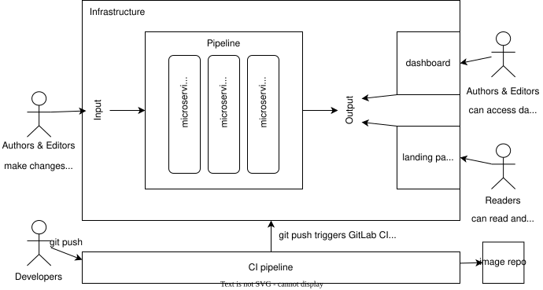
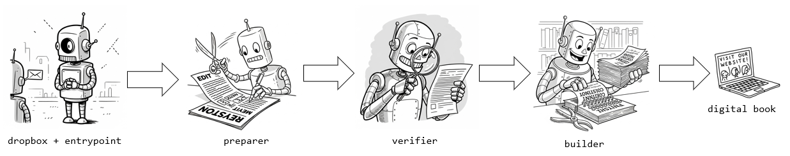

# Architecture

## Design principles

* Flexibility is required as there is no upfront specification. In practice, users of this software (book authors, editors, readers) share their feedback during development process. Especially, no final decision has been made with regard to mode of running the software (see [section about possible options](#flexibility)).
* Sustainability is the highest priority of this project. Books should be hosted as static web pages without a need for dedicated servers. When possible, websites related to the project, like the reader or the dashboard, should not require any application logic on the server-side after web pages are built.
* The functionality of the code should be guessable just by looking at handler function in a `src/<service>/main.py` module. The details of implementing this functionality can be hidden in other modules in this service.
* Code shared between services should be writen and stored in `src/_common/<filename>.py` files. All services copy the `src/_common` directory and use it independently from each other.
* The state of the pipeline (state resulting from processing a manuscript) should be shared using the `DocumentState`" or `BookState` objects. For example, if you want to pass some information from the Preparer service to the Builder service, you should store it in appropriate record in `DocumentState` in Preparer and load from this object in Builder. State is saved in the database, as json files in the file storage shared between services and as json in `<scripts>` tag in html.
* Rely on features of MS Word for `.docx` input, JupyterLab/Notebook for `.ipynb` input and on JupyterBook/MyST for output as much as possible.
* Target MyST specification rather that bespoke solutions.
* The deployment is steered by the `git push` command ran in the develop or master branches. Note however that the code of the services is pulled by the infrastructure from the docker image repository, so the developer has to point to the proper version number in `.versions.json` and push an image tagged with this version before the CI/CD pipeline tries to pull the image from the repo.

## Architecture design

### Architecture overview

The project consists of the following main software components.

| Name                                                        | Layer  | Description                                                                                                                                                             |
| ----------------------------------------------------------- | ------ | ----------------------------------------------------------------------------------------------------------------------------------------------------------------------- |
| [pipeline](src/)                                            | Business Logic     | Services that process input manuscript, verify it, and build output for other apps to use. The pipeline includes multiple services that are described below. |
| [CI pipeline](./.gitlab-ci.yml)                          | DevOps | Set of scripts for applying changes to the infrastructure.                                                                                                              |
| [dashboard](staticws/dashboard/)                            | UI     | Dashboard with tools for authors and editors to help their work on the manuscript.                                                                                      |

Image repo is the docker image repository from where the CI pipeline pulls a specific service code.

The main workflow for generating digital monographies can be simplified as an interaction between the dropbox, entrypoint, preparer, verifier and builder services.

**Digital book workflow**

**Paper book workflow**

### Flexibility among design options

#### Dropbox dependency

The document processing is triggered by a CLI call or an event coming from document collaboration software. The document collaboration software should enable authors and editors to freely work on author's package, including making some changes to chapters written in `.docx` and `.ipynb`, as well as uploading and removing files. Instead of polling, the document collaboration software should communicate events via webhooks. Temporarily, Dropbox was chosen as the document collaboration software, but we plan to change it to a self hosted solution that supports webhooks.

#### Microservices vs running on a single virtual machine

In the beginning of the project there was a discussion about choosing the mode of software execution, i.e. whether to run it on a series of microservices and on a single virtual machine. Both choices have their pros and cons.

For now, we were developing following the microservice* approach, but in a way that will allow me to switch to a server-based solution (or a hybrid solution) if needed. To make development (and potential switch to a single VM) easier, we opt not to implement the "microservice architecture" in the strict sense. For example, there is some common code copied to all services (see `src/_common`) and there is a central database shared between services. In general, services are isolated independent functions that can run in AWS Lambda or other "function-as-a-service" solution.

When considering migration to a server-based solution, please review running the services in separate threads.

#### How Jupyter Books are meant to be served

Jupyter Book v2 can [generate digital books as "static" websites](https://mystmd.org/guide/deployment), but they still need to be served. For example, it can be served with httpd or nginx. It is still undecided how to automate the process of building and deploying books in a scalable and reliable fashion. For example, we could use Jupyter Book v2 [serve functionality](https://github.com/jupyter-book/mystmd/blob/main/packages/myst-cli/src/cli/start.ts) to benefit from cache and fast build-time.

#### Dashboard

We consider two alternative solutions for handling the dashboard for authors and editors:
* [React app separate from the document processing pipeline](staticws/dashboard/)
* [Flask app that serves data with HTML templates + htmx](src/dashboard/main.py)

Aim of the dashboard is to aid authors and editors in book preparation.
