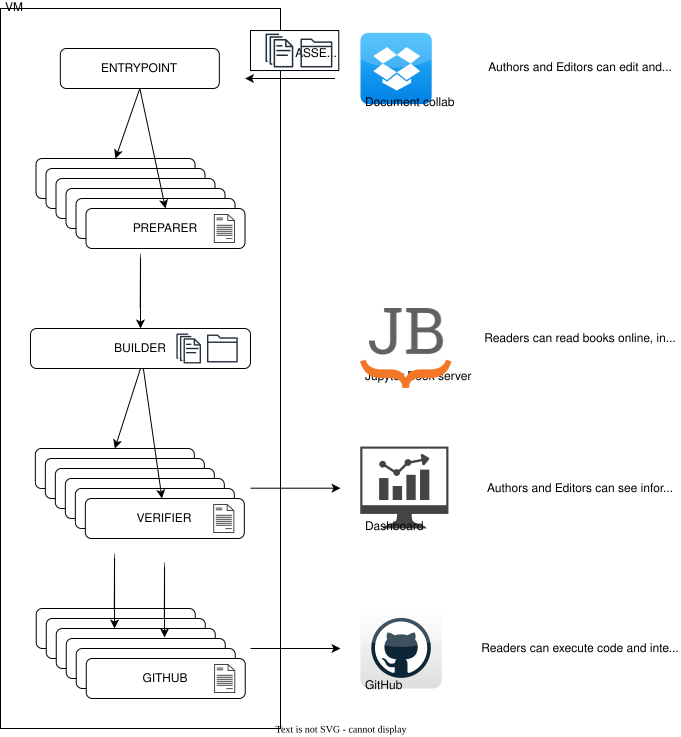

# Pipeline details

The pipeline is the core of the project. It processes books, provides information about them to authors and editors, generates a version for typesetting for printing, as well as triggers Jupyter Book to build a static website to read a book from.

**Single virtual machine**

We are considering moving current microservice patterns to a single VM.



Currently however, the software follows loosely-understood microservice pattern.

**Microservices workflow**


For the full architecture see [the instructions on generating an infrastrucutre visualisation](#generating-infrastrucutre-visualisation) and open the produced `graphviz.html` file.

The architecture attempts to follow the pattern of `... -> s3 upload -> Lambda invoke -> s3 upload -> ...`. Sometimes an upload to s3 can and should invoke multiple Lambda functions. It can be also advantageous to have an SQS queue as a part of the chain. This allows for a modular design, which brings some benefits with it.

The platform consists of the following services (Lambda functions):
| Name              | In VPC? | Description                                                                  |
| ----------------- | ------- | ---------------------------------------------------------------------------- |
| **entrypoint**    | false   | Exposes REST endpoints, incl. OAuth and webhooks to integrate with Dropbox.  |
| **dashboard**     | false   | Experimentation with serving dashboard as a html templates.      |
| **dropbox**       | false   | Calls Dropbox API to retrieve files from Dropbox and writes them to s3. Dropbox is going to be replaced with other document collaboration software with webhooks.      |
| **preparer**      | true    | Prepares a single document. Visibility limited to a current file. |
| **verifier**      | true    | Checks the single uploaded document against the verification rules.          |
| **github**        | false   | Pushes the processed documents to GitHub remote repository.                  |
| **builder**       | true    | Does final transformations with visibility covering ll of author's package. Afterwards, triggers Jupyter Book to build a book out of processed documents.                |
| **gpu**           | false   | Generates pre-signed url from private S3 bucket.                             |
| **orm**           | false   | Middleware between services and the shared database.                    |
| **wordprocessor** | false   | Transforms docx files for the paper version.                                 |

Deployment of each service should be done in order:

| Order | Stage name  | Command | Description |
| ----- | ----------- | ------- | ----------- |
| 1     | **version** | `vim .versions.json`        | In `.versions.json` appropriately increment _latest_ and/or _stable_ version numbers of a service you've made changes to in the `src/<service>` dir |
| 2     | **apply**   | `git push`                  | As you push your changes to GitLab, the CI/CD pipeline is run, including deployment of changes to the infrastructure; if the image version has changed in the `.versions.json`, the Docker container will be updated on the cloud |
| 3     | **build**   | `make <service>/build` | Builds Docker image |
| 4     | **tag**     | `make <service>/tag`   | Tags the image with a tag specified in `.versions.json` |
| 5     | **push**    | `make <service>/push`  | Pushes the image to docker registry (remember to login to the registry with `make login`) |

`make <service>/push` is a useful alias for builing, tagging and pushing a particular service. Note that there is a **race condition** - docker container has to be built, tagged and pushed before the apply stage pulls the image from registry. If CI/CD pipeline job fails with error `Source image <registry>/<image>:<tag> does not exist. Provide a valid source image.` re-run that job. Make sure that you had built, tagged and pushed the image in question.

## Details of each service architecture

Every service consists of:
* Dockerfile
* requirements.txt
* main.py
and optionally other files with implementation details.

`lambda_handler()` function in each `src/<service>/main.py` file is an entrypoint to this service. Data about the event that triggered this service and context in which this service is being run are passed as arguments to `lambda_handler(event, context)`.

The `lambda_handler()` should call abstract wrapper subprocedures, which call concrete subprocedures with the actual logic.

### Wrapper subprocedures

The main role of wrapper subprocedures is to add logging and audit trails to each call of concrete subprocedures.

```py
try:
    from actual_business_logic import concrete_subprocedure
except (ImportError, ModuleNotFoundError):
    from .actual_business_logic import concrete_subprocedure  # type: ignore

def _wrapper_subprocedure(*args, **kwargs) -> t.Any:
    try:
        res = concrete_subprocedure(*args, **kwargs)
        logger.info(
            f"Response from concrete_subprocedure: {json.dumps(res, default=str)}"
        )
        return res
    except Exception as e:
        logger.exception(
            f"Log message. Error: {repr(e)}"
        )
        _log_audit_event(
            key,
            AuditStatus.FAILED.value,
            "Audit trail message.",
        )
        raise
```

### Concrete subprocedures

Concrete subprocedures hide implementation details. Those subprocedures should be located in separate files and not in the main file.

Code common to more than one service should be written in the `src/_common/<module_name.py>` and copied from there to the services using `make copy/<module_name>` command.

### Imports

In this project, we don't strictly implement the service architecture. In particular, there is code shared between services found in `src/_common` directory and some service are connected to a single database.

When arranging imports from modules within a service and from code shared between services, we also have to consider all the ways that a service code might be invoked:
* CMD - the default command to run when a container is started, as defined in a Dockerfile.
* tests,
* scripts (see `tests` and `scripts` directories respecitively).

To accomodate all those different modes, please follow this pattern.

#### In `src/<service>/Dockerfile`

```Dockerfile
FROM public.ecr.aws/lambda/python:3.12

# Install internal dependencies to /var/task
COPY requirements.txt  .
RUN  pip3 install -r requirements.txt --target "${LAMBDA_TASK_ROOT}"

# Copy python modules to /var/task/
COPY ./*.py ${LAMBDA_TASK_ROOT}

# Copy contents of the shared "src/_common" directory to /var/task/src/_common/
RUN mkdir -p ${LAMBDA_TASK_ROOT}/src/_common
RUN --mount=from=common,target=common \
    cp -r common/* ${LAMBDA_TASK_ROOT}/src/_common/

CMD [ "main.lambda_handler" ]
```

#### In `src/<service>/main.py`

```py
# External dependencies
import os
import sys

# Get the current directory and add it to sys.path
current_dir = os.path.dirname(os.path.abspath(__file__))
sys.path.insert(0, current_dir)

# Internal dependencies. Never use explicit relative imports.
from src._common.constants import ...
from mymodule import SOME_VAR
```

#### Please note

* When you want to import a few modules without models or migration data, it is recommended to copy just the files you need.
* Avoid repeating file names (other than `main.py`) across services. Otherwise a module name might be overwritten in `sys.modules` when importing code from different services in tests or scripts, causing a wrong module to be imported (e.g. a mixup between `src/preparer/utils.py` and `src/builder/utils.py`).

## Multiple environments

The project has two cloud environments: main and develop. Each time you run `git push` on the "develop" branch, you  trigger the CI/CD for the "develop" environment. Similarly, when you accept the merge request to the "main" branch, the CI/CD for the "main" branch will be invoked.

## Naming convention

### Infrastructure

Each resource deployed should follow the same naming convention: `<project>-<env>-<awsservice>-<service>-<details>`

* `project` should be always "dgtmon". Helpful e.g. when you look for a IAM Policy related to the project - just start typing the name of the project and you'll filter only relavant items.
* `env` is generally the name of the environment ("main" or "develop"). For shared resources (e.g. ECR images) and for legacy resources it can be equal to "dev".
* `awsservice` is the abbreviation of a infrastructure resource. It should anwser the question: "what is it".
* `service` is the related service, like "builder" or "preparer". `service` can also be "general" or "gen" if the resource is for general use. You can also leave it empty.

For example, the full name of a resource could be
`dgtmon-main-s3-verifier-logs-warning`.

It is highly recommended to define `<awsservice>-<service>-<details>` as Terraform variable in `infra/variables.tf` file. The value has to be then filled in the `secrets/encrypted.tfvars.json` using the "sops" tool.

Then, when defining resources in the `.tf` files use variables:
```tf
resource "aws_awsservice_awsresource" "some_name" {
  name = "${var.project}-${var.env}-${var.some_name_set_in_variables}"
}
```
