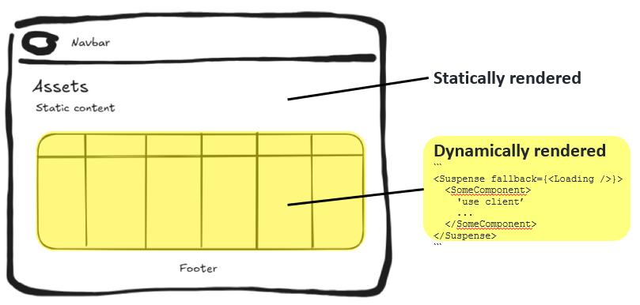

# Dashboard

## Tech stack

Tech stack for the frontend:
- React - as ui framework
- Bootstrap - for ui components
- Next.js - as a build tool, _DO NOT_ use it for anything else than build or routing

## Updating

Note that the dashboard is updated every time you execute `git push` command.

* build-dashboard - builds the static website
* upload-dashboard - uploads the static website to the cloud

## Development

To run the app locally, run the following command

```sh
npm install
npm run dev
```

You can also run `npm run build` to build the static website locally. Be caution about the differences that might occur between your local build and build done by CI pipeline on GitLab's server.

## Statically vs dynamically rendered

This app is supposed to work as a static website, but at the same time have some components that are dynamically rendered. This section aims at describing how this is achieved.



### Statically rendered

This part of HTML is generated at the build time, rather than on each request. Since the HTML is pre-generated, it can be served very quickly to users. 

If your page needs to fetch data after build (e.g. when a user opens a page) use a React's client component wrapped in a `<Suspense>` object.

### Suspense

`<Suspense>` lets you display a fallback until its children have finished loading. See the [docs](https://react.dev/reference/react/Suspense) for further information.

### Client component (dynamically rendered)

`'use client'` directive lets you mark what code runs on the client. You could use this to fetch data from database in the cloud.

A component usage is considered a Client Component if it is defined in module with `'use client'` directive or when it is a transitive dependency of a module that contains a `'use client'` directive. See the [docs](https://react.dev/reference/rsc/use-client) for more information.
